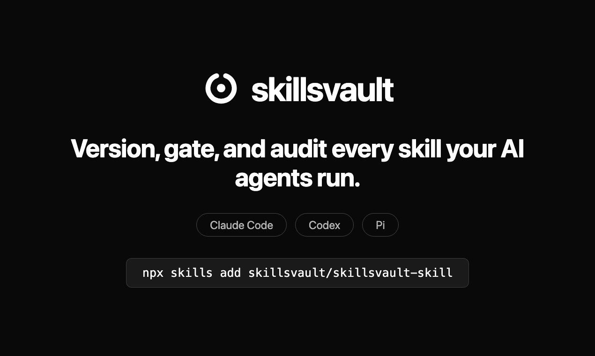

<div align="center">



<br />

[](https://skillsvault.io)
[](https://skillsvault.io/docs)
[](./LICENSE)

**The control plane for agent skills.**
One skill that connects your agent to your organisation's registry —
install what's approved, block what's banned, audit everything.

Works with **Claude Code** · **Codex** · **Pi** · every other harness

</div>

---

## ⚡ Add it to your agent

```bash
npx skills add skillsvault/skillsvault-skill
```

That's it. Your agent reads the skill and bootstraps itself — it installs the
`skillsvault` CLI, asks you to sign in once, then pulls your organisation's
approved skills into every harness on the machine:

```bash
curl -fsSL https://skillsvault.io/install.sh | sh
skillsvault login
skillsvault pull --all
```

### As a Claude Code plugin

```bash
claude plugin marketplace add skillsvault/skillsvault-skill
claude plugin install skillsvault@skillsvault
```

The first time Claude uses it, run `/mcp` and sign in to skillsvault: you pick your organisation, and no key is pasted or stored in a file. The plugin adds:

- **The skillsvault skill**: the same skill as above.
- **The skillsvault MCP server**: `list_skills`, `load_skill` and `get_skill_file` let Claude read your organisation's approved skills. All three are read-only. A skill your policies block is refused, with the reason.
- **The gate hook**: before Claude runs a skill, subagent or typed `/command`, it asks the `skillsvault` CLI whether your organisation allows it. A block shows the policy's reason and a link to request an exception. The hook does nothing until the CLI is installed, and steps aside if `skillsvault install-hook` already wired the gate.

### In other agents

The same repository is a plugin for other agents too. Each one signs you in to skillsvault the first time it connects:

- **Cursor, Codex and ChatGPT:** add the MCP server `https://skillsvault.io/api/mcp`. Marketplace listings are on their way; the plugin already follows the [Agent Plugins](https://agent-plugins.org) standard (`plugin.json`, `mcp.json`, `skills/`).
- **Gemini CLI:** `gemini extensions install https://github.com/skillsvault/skillsvault-skill`
- **Anything else that speaks MCP:** add `https://skillsvault.io/api/mcp`. It is listed in the official MCP Registry as `io.skillsvault/skillsvault`.

### What it sends, and where

- **MCP server.** It calls `https://skillsvault.io/api/mcp` as you, once you sign in. It sends the skill names Claude asks for, and receives your organisation's skill content. Each load is recorded in your organisation's audit log.
- **Gate hook.** It runs on your machine against a signed copy of your organisation's policies, with no network call per decision. The CLI reports each decision (skill name and version, decision, reason, machine name) to your organisation's audit log. It also sends a periodic heartbeat (CLI version, whether the gate hook is wired, and the names of the skills installed on the machine), so your organisation can see which machines are covered.
- **Nothing else.** Nothing is sent anywhere other than skillsvault.io. Your prompts and code are never sent. See the [privacy policy](https://skillsvault.io/privacy).

## 🎬 See it work

<div align="center">

</div>

## 🧭 Why

Agents pick up skills from everywhere — repos, marketplaces, teammates, other
agents. Nobody knows which version runs where, and a poisoned or outdated
skill looks exactly like a good one. skillsvault gives your organisation one
source of truth:

| | |
|---|---|
| 📦 **Versioned registry** | Every skill content-addressed, versioned, and signed. `pull` installs the approved version — and removes banned ones. |
| 🚦 **The gate** | Every invocation checked locally, before it runs: **allow / warn / halt**. Works offline from a cached policy bundle. |
| 🧾 **Audit trail** | Who ran which skill version, on which host, under which policy — append-only and exportable. |
| 🕸️ **Every harness** | One policy for Claude Code, Codex, Pi, and anything else that runs skills. |

## 🛠️ What your agent does with it

Once connected, the skill teaches your agent to govern itself:

```bash
skillsvault whoami                    # which org am I connected to?
skillsvault install-hook              # gate every skill invocation (Claude Code)
skillsvault pull --all                # install approved skills, remove banned ones
skillsvault gate --skill <org/skill>  # allow / warn / halt — before use
skillsvault publish <path>            # push a skill to the org registry
skillsvault status                    # how fresh is the policy bundle?
```

Three rules the skill enforces, always:

1. If the gate **halts** a skill → the agent does not run it. Ever.
2. The approved version from `pull` beats any sideloaded copy.
3. A halt is never bypassed — the verdict names the approved replacement.

## 📚 Learn more

- 📖 [Documentation](https://skillsvault.io/docs) — CLI reference, policies, the signed bundle contract
- 🚀 [Quickstart](https://skillsvault.io/docs/quickstart) — zero to governed in five minutes
- 🔍 [`SKILL.md`](./skills/skillsvault/SKILL.md) — the skill itself, exactly what your agent reads
- 🧾 [`references/cli.md`](./skills/skillsvault/references/cli.md) — full command reference

## License

Apache-2.0 — see [LICENSE](./LICENSE). This covers the skill and plugin in this repository; the skillsvault service is governed by its [terms](https://skillsvault.io/agb).

<div align="center">
<sub>Built in Germany 🇩🇪 · <a href="https://skillsvault.io">skillsvault.io</a> · <a href="mailto:info@skillsvault.io">info@skillsvault.io</a></sub>
</div>
